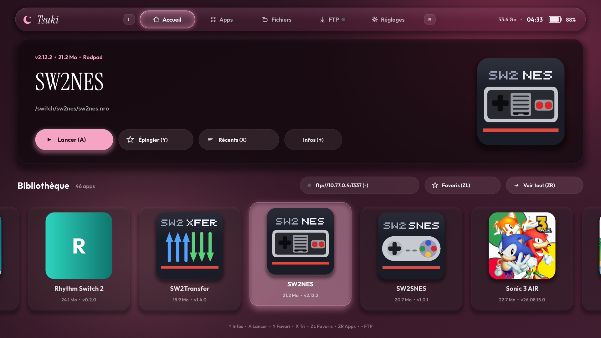
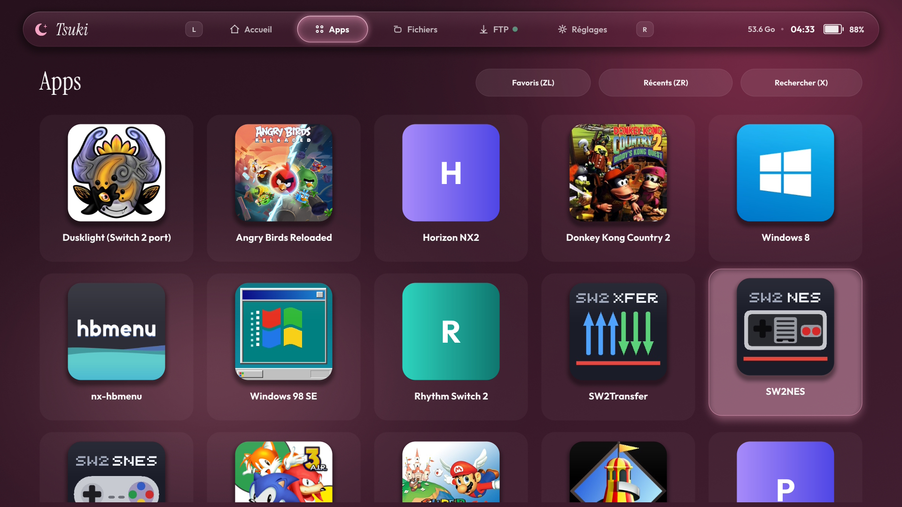
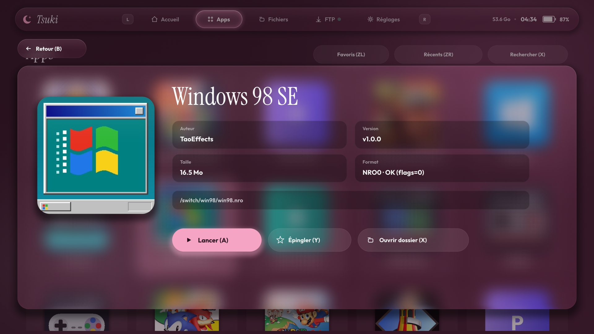
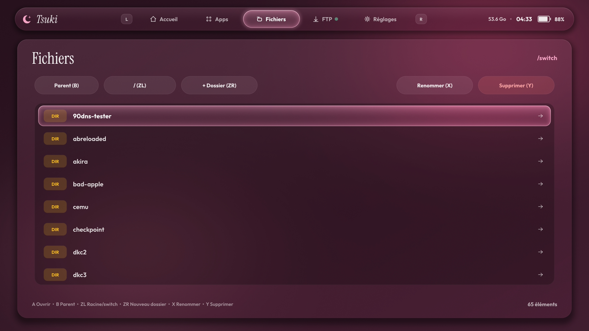
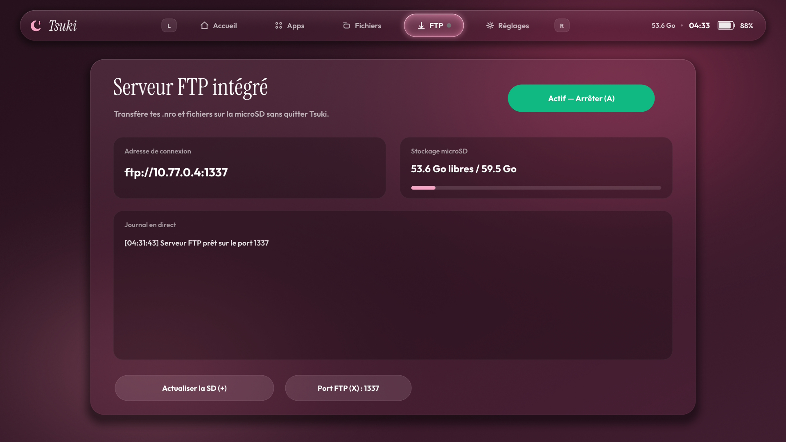

<p align="center">
  
</p>

<h1 align="center">Tsuki</h1>

<p align="center">
  <strong>A native 1080p 120 Hz Liquid Glass Homebrew Launcher for Nintendo Switch 2.</strong><br/>
  Inspired by <a href="https://github.com/TaoEffects/yoru">Yoru</a> — featuring real-time GPU Kawase backdrop blur, built-in background FTP server, microSD file manager, and full gamepad / touch / Joy-Con 2 mouse support.
</p>

---

## Screenshots

<p align="center">
  
</p>

| App Drawer | Liquid Glass App Detail |
| :---: | :---: |
|  |  |

| microSD File Manager | Built-in FTP Server |
| :---: | :---: |
|  |  |

---

## Features

- **Native 1920×1080 @ 120 Hz + VRR** powered by OpenGL ES 3 (`libounce` + OunceVK).
- **Real-Time GPU Liquid Glass**: 3-pass Kawase backdrop blur FBO with subtle edge lens refraction, top sheen, and soft Yoru-style inner velvet glow.
- **6 Yoru Themes**: *Framboise* (default), *Nuit*, *Iris*, *Lagon*, *Pêche*, and *OLED*.
- **5 Built-in Languages**: **Français**, **English**, **日本語** (using Switch 2's native system shared font fallback via `pl:u`), **Español**, and **Deutsch**.
- **Home & Android-Style App Drawer**:
  - Unified Hero banner with faded artwork, sorting (*Recent*, *A → Z*, *Size*), favorites pinning, and instant search.
  - Fullscreen App Detail sheet with smooth open/close animations, NRO metadata (`NACP` author, version, size, `NRO0` flags), favorite toggle, and jump-to-folder.
- **Integrated Background FTP Server**:
  - Runs silently in the background while browsing (configurable ports: `1337`, `5000`, `2121`).
  - Automatically refreshes the homebrew library whenever files are uploaded to `/switch/`.
- **Built-in microSD File Manager**:
  - Browse `sdmc:/`, launch `.nro` files, preview text/code and images (`PNG`/`JPG`/`BMP`), create folders, rename, and delete.
- **Full Input Support**:
  - 100% controllable via Joy-Con / Pro Controller (handheld & docked), Touch Screen, Joy-Con 2 Mouse Mode (`nmouse`), and USB Mouse.
- **Native 48 kHz Synthesized UI Audio** via `audout` (can be muted in Settings).

---

## Installation

### As your main Homebrew Menu (recommended)
1. Back up your existing `/hbmenu.nro` on your microSD card (for example to `/switch/hbmenu-stock/hbmenu.nro`).
2. Copy `tsuki.nro` to the root of your microSD card as `/hbmenu.nro`.

### As a standalone homebrew
- Copy `tsuki.nro` to `/switch/tsuki/tsuki.nro` and launch it from your current homebrew menu.

Configuration, favorites, and recent launch timestamps are saved automatically to `/switch/tsuki/config.ini`.

---

## Controls

| Context | Button | Action |
| :--- | :--- | :--- |
| **Global** | `L` / `R` | Switch tabs (*Home · Apps · Files · FTP · Settings*) |
| **Global** | `-` | Start / Stop integrated FTP server |
| **Global** | `+` | Refresh microSD & rescan homebrews |
| **Home** | `←` / `→` | Select homebrew |
| **Home** | `A` | Launch selected homebrew |
| **Home** | `↑` | Open App Detail page |
| **Home** | `Y` | Pin / Unpin favorite |
| **Home** | `X` | Cycle sort (*Recent / A → Z / Size*) |
| **Home** | `ZL` | Toggle Favorites-only filter |
| **Home** | `ZR` | Open All Apps drawer |
| **Apps Drawer** | `A` | Open App Detail page |
| **Apps Drawer** | `Y` / `ZL` / `ZR` / `X` | Favorite / Favorites filter / Sort / Search |
| **App Detail** | `A` / `Y` / `X` / `B` | Launch / Favorite / Open folder / Close |
| **Files** | `A` / `B` | Open or preview / Parent folder |
| **Files** | `ZL` / `ZR` / `X` / `Y` | Jump `/` ↔ `/switch` / New folder / Rename / Delete |
| **FTP** | `A` / `X` | Start or Stop FTP / Cycle FTP port (`1337` / `5000` / `2121`) |
| **Settings** | `↑` / `↓` · `←` / `→` / `A` | Navigate & modify settings |

---

## Building from Source

Requires a Switch 2 `devkitA64` + `libounce` + `OunceVK` toolchain (`DEVKITPRO`).

```bash
export DEVKITPRO=/path/to/devkitpro
./switch2/build.sh
```

The compiled NRO (`flags=0`, without `--alignedheader`) is written to `build-switch2/tsuki.nro`.

---

## License & Credits

- Licensed under the [MIT License](LICENSE).
- Typography: [Outfit](https://fonts.google.com/specimen/Outfit) & [Instrument Serif](https://fonts.google.com/specimen/Instrument+Serif) (SIL Open Font License 1.1).
- Single-header image/font decoders: `stb_image` & `stb_truetype` (Public Domain / MIT).
